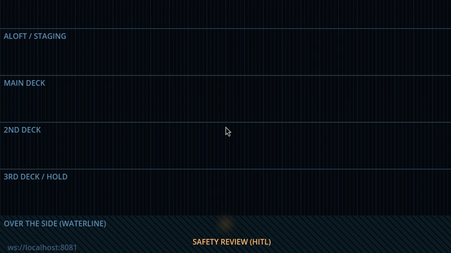

# watchstander

[](https://github.com/COSMOAGNOSTIC/watchstander/actions/workflows/tests.yml)
[](https://opensource.org/licenses/Apache-2.0)

A LangGraph-based multi-agent system for **OSHA 1915 (Shipyard Employment)** spatial and temporal safety deconfliction. Built by a 26-year Navy watchstander — this agent graph stands watch over shipyard safety the same way sailors stand watch over their ship.



Every deconfliction check, safety-brief synthesis, and HITL gate pause is broadcast as a WebSocket event ([`agent_core/events.py`](agent_core/events.py)). An optional Godot 4 scene ([`visualizer/`](visualizer/README.md)) places work packages on a notional schematic by frame range and deck level, draws conflicts as red links, and shows a flagged package waiting at the Safety Review station until a person decides. The GIF above is that schematic.

## Current status

> **As of 2026-11-10.** This block is the one place to check where the project stands; other docs carry their own history.

| | |
|---|---|
| On `main` | Upgrade Sessions 1–11: named rules, the four-input status gate, certificates, judgment flags, crews and shifts, the shift suggester, Apply that re-checks, the decision log, the notional carrier dataset and daily brief. 546 tests. |
| Reviews | Four independent reviews (01–04), every finding fixed and re-checked. Review 05 (red team, 11 findings): first re-check confirmed 5 and reopened 6; 5 are fixed again on branch `fix-review-05`, 1 waits on a decision, then a second re-check. Details in [`reviews/`](reviews/). |
| In progress | Review 05 fixes (second re-check pending); Session 12 web showcase (branch `session-12-showcase`, mockup approved). |
| Next | Sessions 13–15 make the showcase live; Session 16 is the final review and this README's rewrite. Plan and status: [MIGRATION.md](MIGRATION.md#upgrade-plan--16-sessions-started-2026-11-04). |
| Separate | [`retrieval/`](retrieval/README.md) is a standalone hybrid-retrieval subproject, last worked on 2026-08-21, not wired into the graph. |


## What it does

Shipyard work packages (jobs, permits, tasks) carry spatial metadata (compartment, frame range, deck level, aloft or over the side), a schedule, a crew, and the permits they require. Watchstander checks every package deterministically and routes anything that isn't clean to a mandatory **human review gate** before it can be cleared:

```
  conflicts between packages (hazard pairs, overhead work, fire-watch capacity) --+
  judgment flags (things the engine can't decide: unlocated or adjacent work,   |
                  simultaneous entries, inconsistent labels) --> a named person |
  certificate coverage (every required permit valid for the WHOLE job) ---------+--> any finding --> human review
  schedule rules (crew exists, inside the shift calendar, contractor windows,   |
                  no crew double-booking) --------------------------------------+
  nothing found --> passes through cleared
```

- **Every finding cites a named rule** (`WS-HZ-001`, `WS-CT-001`, ...) with its CFR/NAVSEA citations and who to call. Only citations read against the primary source are marked verified; every 29 CFR citation is still marked unverified.
- **Status is an AND gate.** A package or project rolls up `CLEARED` only when its review, certificate, judgment and schedule checks are all clean. A check that wasn't run is never read as clean.
- **Fix suggestions are deterministic and never applied automatically.** The shift-aware suggester moves a whole crew's block to the next open shift, re-checked against every rule, and lists why each rejected shift failed. In the reviewer, **Apply** re-checks first, starts a new run with the moved times, supersedes the old run's reviews, and never approves anything: every moved package still needs a human decision.
- **The LLM explains, never decides or suggests.** It may phrase a brief's summary; the recommended action always comes from deterministic code. Every brief carries a provenance tag (LLM synthesis, deterministic fallback, or deterministic template).
- **Every decision is logged.** An append-only (database-enforced), hash-chained decision log records who decided what, when and why, including refused decisions, Applies, supersessions and crash recovery.

Case grounding comes from public OSHA/DOL records of real shipyard incidents (`case_data/cases_v1.json`). A work package tagged with `governing_installation` (e.g. `"PSNS"`) is also cited against that installation's governing procedure: currently the public-domain NAVSEA 8010 Manual (fire prevention/hot work only) for PSNS. This is deliberately not a universal Navy-wide ruleset. See `agent_core/procedural_lookup.py`.

**About the data.** The default demo is a notional carrier (`case_data/carrier_notional_v1.json`): ship, compartments, crews, permits and projects are all invented, and each scenario is built to trigger one named rule. The roster in `case_data/roster_notional_v1.json` is invented too. An earlier demo built from public drawings of a real cutter was deleted in Session 10. The OSHA cases are public records of real incidents and are case grounding, not demo data.

**Daily brief.** `python -m agent_core.daily_brief --as-of 2027-03-15T06:00` prints a plain-text brief of the notional dataset: projects by priority, every package that needs a person with its rule and who to call, suggestions marked not applied, and (with `--db`) the decision log's head hash for checking later that nothing was cut off the end. Deterministic code only.

## Architecture

```mermaid
flowchart LR
    classDef core fill:#1f6feb,stroke:#0d419d,color:#fff,stroke-width:1px
    classDef gate fill:#da3633,stroke:#8e1c1a,color:#fff,stroke-width:1px
    classDef data fill:#8250df,stroke:#5a32a3,color:#fff,stroke-width:1px
    classDef live fill:#2da44e,stroke:#1a7f37,color:#fff,stroke-width:1px
    classDef schema fill:#57606a,stroke:#32383f,color:#fff,stroke-width:1px

    Entry(["entry"]) --> Deconf["deconfliction_node<br/>(deconfliction.py)<br/>hazard pairs, overhead, fire watch"]
    Deconf --> Judg["judgment_node<br/>(judgment.py)<br/>calls the engine can't make"]
    Judg --> Find["findings_node<br/>(findings_gate.py)<br/>certificates + schedule rules"]
    Find --> Reason["reasoning_node<br/>(reasoning.py)<br/>SafetyBrief + crew-shift suggestion"]
    Reason --> HitlPrep["hitl_prepare_node<br/>(hitl.py)<br/>splits clean vs. needs-review"]
    HitlPrep -->|"nothing found"| End(["END"])
    HitlPrep -->|"Send() fan-out, one per package"| Hitl["hitl_gate_single_node<br/>(hitl.py)<br/>interrupt(): a real human pause"]
    Hitl --> End

    class Entry,Deconf,Judg,Find,Reason,HitlPrep core
    class Hitl gate

    CaseData[("case_data/<br/>OSHA cases, NAVSEA 8010,<br/>named rules, notional roster")] --> Reason
    CaseData --> Judg
    class CaseData data

    Hitl --> Reviewer["reviewer/<br/>FastAPI: approve / reject / Apply<br/>+ decision log"]
    class Reviewer gate

    Deconf --> Events["events.py<br/>WebSocket broadcaster"]
    Reason --> Events
    Hitl --> Events
    Events --> Viz["visualizer/<br/>Godot 4 live scene, notional schematic"]
    class Events,Viz live

    Eval["eval/<br/>fixed-scenario harness vs. checked-in baseline"] -.->|"regression-tests"| Deconf
    class Eval schema
```



*The larger annotated diagram at [`docs/architecture-diagram.html`](https://cosmoagnostic.github.io/Watchstander/architecture-diagram.html) predates the judgment and findings steps; the diagram above is current.*

**Detection and gates**
- **`agent_core/state.py`**: `WorkPackageState` schema: hazards, location, schedule, crew, lock, permits, review state.
- **`agent_core/deconfliction.py`**: deterministic conflict detection (incompatible hazard pairs, overhead work over other work, fire-watch capacity). No LLM.
- **`agent_core/judgment.py`**: judgment flags (WS-JF-001 to 006) for calls the engine can't make, routed to a named person on the notional roster (Gas Free Engineer or Safety Officer).
- **`agent_core/certificates.py`**: certificates with valid-from/valid-until, checked against the whole work window.
- **`agent_core/crews.py`**: crews, shift calendar, locked packages, contractor windows, and the schedule rules (WS-SC-001 to 004).
- **`agent_core/findings_gate.py`**: routes certificate and schedule findings to human review.
- **`agent_core/named_rules.py`**: the rule catalogue (`case_data/named_rules_v1.json`): IDs, citations, who to call.
- **`agent_core/projects.py`**: projects, priority, due dates, and the four-input status gate.
- **`agent_core/validation.py`** / **`agent_core/intervals.py`**: shared input validation (non-blank IDs, one time convention, real-time comparison) and window coverage.

**Suggestions, briefs and review**
- **`agent_core/shift_suggester.py`**: moves a whole crew block to the next open shift, re-checked against every rule. Never applied by itself.
- **`agent_core/reschedule_suggestion.py`**: the older single-package nearest-offset search (not wired into the graph or reviewer).
- **`agent_core/reasoning.py`**: provenance-tagged `SafetyBrief` grounded in a sourced case and procedure. Deterministic recommendation, optional LLM phrasing.
- **`agent_core/retrieval.py`** / **`agent_core/procedural_lookup.py`**: TF-IDF case ranking and site-scoped procedure lookup.
- **`agent_core/hitl.py`** / **`agent_core/graph.py`**: the `interrupt()` review gate and graph assembly.
- **`agent_core/decision_log.py`**: append-only, hash-chained decision log, with a head hash to record elsewhere and check later.
- **`agent_core/daily_brief.py`**: plain-text daily brief from the same deterministic checks; no LLM.
- **`reviewer/`**: local FastAPI reviewer: full brief and provenance, approve/reject, Apply (re-checks first), and a `/log` page. One reviewer service per database (see [`reviewer/README.md`](reviewer/README.md)).

**Rules, data, visuals, evaluation**
- **`agent_core/rules_config.py`** / **`agent_core/rules_audit.py`**: declarative hazard rules (`case_data/hazard_rules_v1.json`) and an append-only rule-change audit trail.
- **`agent_core/carrier_demo.py`**: loads the notional carrier dataset (`case_data/carrier_notional_v1.json`), refusing anything not marked notional.
- **`case_data/`**: OSHA/DOL cases, the PSNS NAVSEA 8010 ruleset, hazard rules, named rules, the notional roster and the notional carrier dataset.
- **`agent_core/events.py`** / **`visualizer/`**: WebSocket events and the Godot 4 live scene on a notional schematic.
- **`eval/`**: fixed-scenario evaluation harness against a checked-in baseline, plus a detection-latency benchmark.

## Watch It Live

`agent_core` broadcasts a WebSocket event at each stage of the graph — no configuration needed, it's a no-op until something connects. Open [`visualizer/`](visualizer/README.md) in Godot 4, run the main scene, then run [`visualizer/demo_broadcaster.py`](visualizer/demo_broadcaster.py) (no API key required) and watch work packages resolve through deconfliction, reasoning, and the Safety Review gate in real time on a schematic of the notional carrier. The visualizer's Godot scene was updated in Session 10 without a Godot run; see [`visualizer/README.md`](visualizer/README.md).

The visualizer only shows *that* a package is flagged, deliberately never *why* (see `events.py`'s broadcast policy, ARCHITECTURE.md Section 8). For the actual human decision (reading the full brief, approving or rejecting, applying a suggested shift move, and reading the decision log) see [`reviewer/`](reviewer/README.md): `pip install -e ".[dev,reviewer]"`, `uvicorn reviewer.app:app --reload`, seed the notional carrier demo, and work the review queue.

## Project Docs

- [AGENTS.md](AGENTS.md): the working rules every session follows (also loaded through [CLAUDE.md](CLAUDE.md)): tests first, deterministic safety logic, the review loop, and the review cost policy.
- [ARCHITECTURE.md](ARCHITECTURE.md): component map, design principles, Known Debt, decision log (ADRs).
- [MIGRATION.md](MIGRATION.md): phased build history, including the 16-session upgrade plan and its status.
- [PASSDOWN.md](PASSDOWN.md): session-by-session continuity notes.
- [AOSE.md](AOSE.md): the adversarial review discipline, with real instances from this repo's history. Start with ["Who the adversary is"](AOSE.md#who-the-adversary-is-review-05-as-the-worked-example): 9 of the 11 red-team findings came from ordinary people on a bad day, not attackers.
- [`reviews/`](reviews/): every cross-model review: the reviewer's findings, the builder's independent verdicts, the fixes, and the re-checks.
- [PHILOSOPHY.md](PHILOSOPHY.md), [SECURITY.md](SECURITY.md).

## Installation

```bash
pip install -e ".[dev,retrieval,reviewer]"
```

This is exactly what CI installs. The `retrieval` extra pulls in PyTorch through `sentence-transformers`, so the first install takes several minutes.

## Testing

```bash
pytest -v
python -m eval.run_eval
```

Use plain `pytest`, not `python -m pytest` (see AOSE.md, "verification blind spot"). GitHub Actions runs the full suite on Python 3.11 and 3.12 for every push and pull request.

## Sub-projects

- [`retrieval/`](retrieval/README.md) — a separate RAG (retrieval-augmented
  generation) skills-building harness applying semantic search + citation
  grounding to this repo's regulatory corpus. Standalone teaching project,
  not wired into the live deconfliction graph above; has its own phased
  plan and doc set — see [`retrieval/README.md`](retrieval/README.md).

## Scope (v1)

Public-domain, civilian shipyard OSHA data only. No Navy mishap data — deliberately excluded to avoid classification/aggregation concerns, not an oversight. See `PASSDOWN.md` Section 7 for the full out-of-scope list.

## License

Apache License 2.0 — see [LICENSE](LICENSE).
